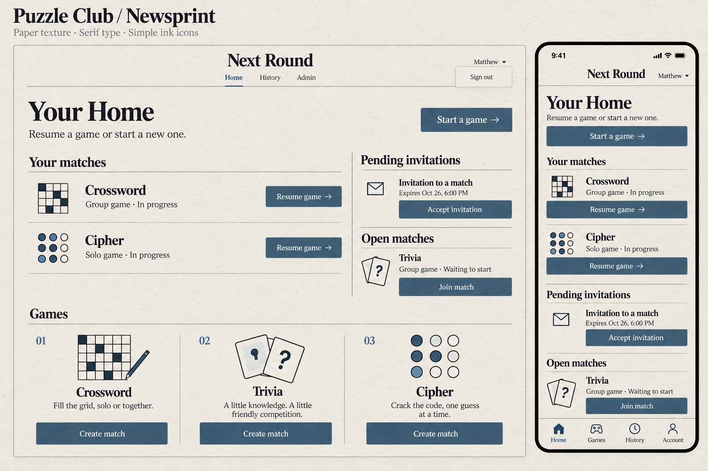
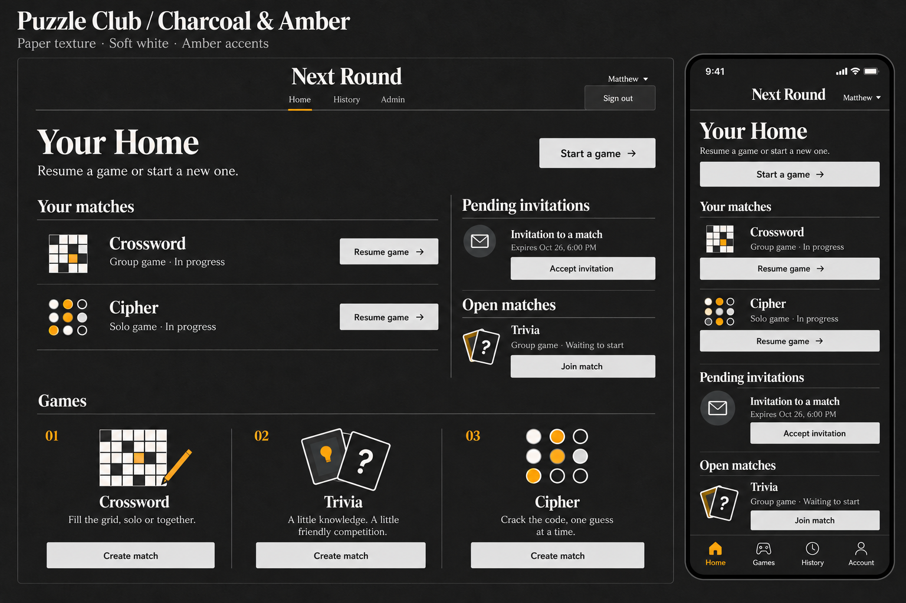

# Puzzle Club interface

Matthew selected the uncluttered newspaper crossword/word-puzzle direction: serif typography, simple ink illustrations, thin rules and a surface that feels like paper. Light mode uses Newsprint; dark mode uses the supplied reference's charcoal, soft-white and restrained amber palette. The supplied dashboard was a color reference only.

## Design references

These are the selected Image Gen concepts, not screenshots of running software:

The browser captures below show the implemented application with synthetic API fixtures. They are not real account history:

| Desktop | Phone |
| --- | --- |
| [Newsprint](screenshots/desktop-light.png) | [Newsprint](screenshots/mobile-light.png) |
| [Charcoal & Amber](screenshots/desktop-dark.png) | [Charcoal & Amber](screenshots/mobile-dark.png) |

## Design system

| Role | Newsprint | Charcoal & Amber |
| --- | --- | --- |
| Paper/background | `#f4f1e8` | `#171717` |
| Ink | `#242729` | `#f5f3ee` |
| Secondary text | `#575b5d` | `#b5b4af` |
| Action fill | `#405b70` | `#e5e5e5` |
| Action label | White | `#111111` |
| Illustration/navigation accent | Slate blue | `#ffab16` |
| Printed rule | `#bcb9af` | `#525252` |

The semantic tokens live in `packages/ui/src/styles/globals.css`. Legacy game/shell styles alias those tokens rather than maintaining a second palette. The `.dark` class and `data-theme` attribute are updated together.

Georgia, Times New Roman and the device's serif fallback provide the editorial type. Controls and navigation use the sans-serif UI stack. Masthead and page titles use tight tracking; smaller labels and status text remain readable. The Home layout has an open heading/action row, divided current-match rows, a narrow invitation/open-match rail and a three-column games index. At phone widths these become a single reading column and labeled bottom navigation, with safe-area padding. Status always includes words rather than relying on color.

The three familiar games use small theme-aware SVG ink illustrations (grid, question cards and code pegs); unknown modules get a neutral game tile. These are decorative, with visible game names supplying accessible labels. UI controls and all text remain live HTML. The existing shadcn Radix Button is reused, with a 44px default action size. No preset or dependency versions changed.

The generated uncoated-paper texture is a single local WebP tile, approximately 195 KiB, rendered at low opacity behind the document. It has no pointer interaction and does not rasterize or blur text. Dark mode uses the same tile with a different blend strength. No remote asset requests or raster screenshots are used as application UI.

## Appearance behavior

The sun/moon control switches between the two themes. Before the first stylesheet paint, `public/appearance.js` applies a valid saved preference from `next-round:appearance:v1`, otherwise the OS preference. The React control persists explicit selections, follows OS changes when there is no selection, and synchronizes changes across tabs. Storage failures keep the page usable; an explicit choice still applies in memory for that page.

## Interaction and content

Start, resume, join, accept, create, sign-out, History and Admin use the existing routes and commands. The catalog uses the short descriptions from the approved concepts for Crossword, Trivia and Cipher; other modules retain their manifest descriptions. Mode choices remain available in the creation dialog. No game rules, permissions, API contracts or database behavior changed.

The Games link now targets the actual catalog and scrolls once per navigation, including entry from another route; live refreshes do not repeatedly snap the reader back to it. It is omitted for guests, whose Home deliberately has no catalog. Admin remains visible only for administrators. A skip link, keyboard focus indicators, dialog focus restoration, large phone actions and reduced-motion handling are retained or added.

## Fidelity review and intentional adaptations

The selected concepts and final captures were inspected with `view_image`. The browser implementation was verified against their masthead/heading hierarchy, column and row structure, paper/ink palettes, flat action geometry, simple illustration family, whitespace and phone reflow. The implementation follows the selected design with these explicit product adaptations:

- A labeled sun/moon appearance control is needed to operate the requested themes; it occupies the masthead's free space.
- Real account identity/sign-out controls remain visible. Administrators have a fifth phone navigation item, preserving Admin access; guests have no catalog link.
- Reusable SVG ink icons and native serif fallbacks provide sharp scalable rendering. Generated typography and texture cannot be treated as an exact cross-device font or pixel measurement.
- Dates, game availability, invitation count, long names, errors and empty/loading states come from actual API data. The reference's sample content is not hardcoded into production.

Above-the-fold copy matches the selected Home heading, intro, section names and actions. The new theme control is the necessary added affordance. Existing alerts and authorization-specific content remain conditional. No decorative hero, dashboard statistics, card grid or unrelated feature was added to Home.

See [validation](validation.md) for checks, viewport evidence and limits. This PR implements the app UI; the concept PNGs are documentation only.
